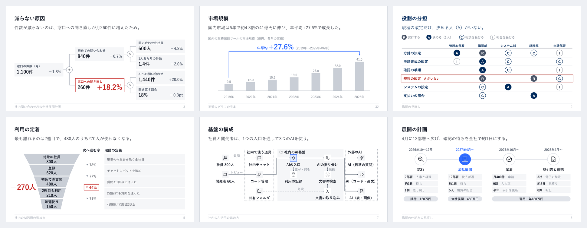
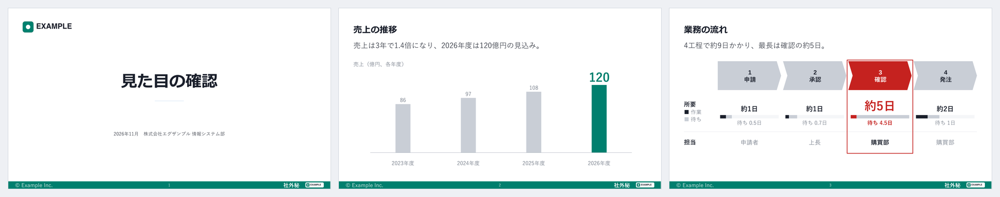
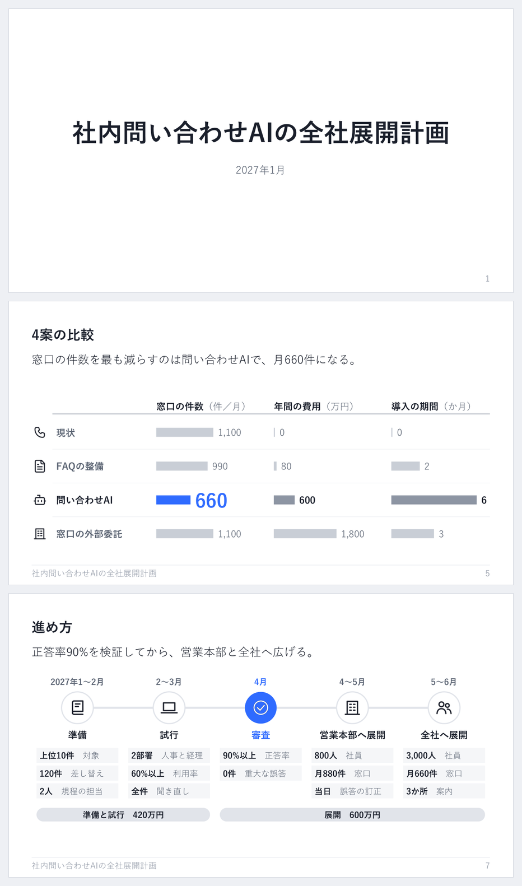
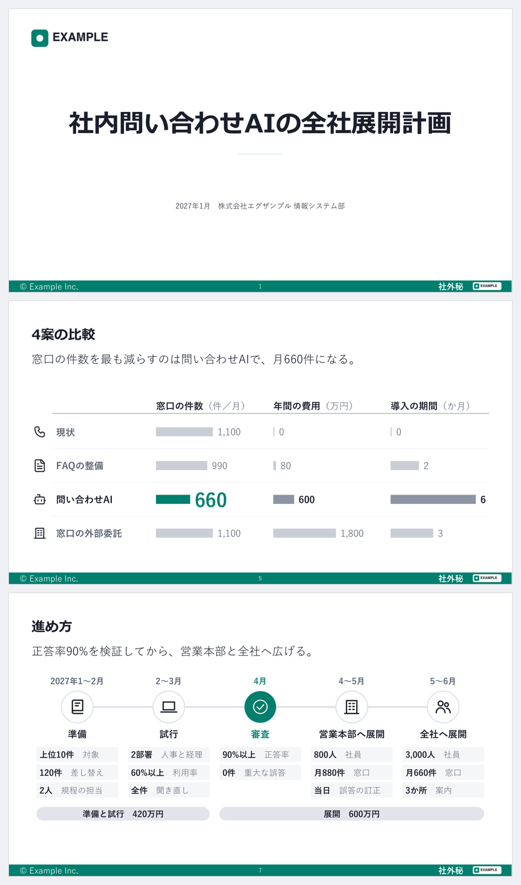

# pptx-deck-kit

Claude Code で、PowerPoint の資料（.pptx）を作るためのプラグイン。資料は `build.js`（[pptxgenjs](https://gitbrent.github.io/PptxGenJS/)）で組み立てるので、作り直しても同じものが出て、差分も追える。



上の6枚は、どれも同梱の見本（`sample-*.js`）から作ったもの。内容は架空。

中身は「資料づくりの型」。部品のライブラリ、各ページの見せ方の決まり、画像にして点検する手順を、Claude Code のスキル3つにまとめてある。

- **1ページ1メッセージ**：題はいまどの話か（項目名）だけ、主張はリードの1文、図は1つ
- **見る所を1か所に**：グラフは見る所だけを強調の色にし、値を大きく書く。他は灰
- **形は伝えたいことから選ぶ**：比べる・内訳・推移・原因・流れ・計画ごとに、使う図と使わない図を決めてある
- **作ったら、画像にして確かめる**：部品が警告を出し、点検の項目で1ページずつ見直す

## 入れ方

Claude Code 2.1.275 以降。ターミナルで次の1行。

```bash
claude plugin install pptx-deck-kit --marketplace wataru-yt/pptx-deck-kit
```

Claude Code の中なら、次の1行。

```
/plugin install pptx-deck-kit --marketplace wataru-yt/pptx-deck-kit
```

入るもの：スキル `pptx-deck-kit:pptx-deck-design`（見せ方の決まりと部品）と `pptx-deck-kit:pptx-build-sync`（build.js と pptx を一致させ、画像にして確かめる手順）と `pptx-deck-kit:theme`（色・ロゴ・文字の大きさなどの見た目を決める。`/pptx-deck-kit:theme` で呼ぶ）。pptxgenjs は、入れたときに自動で入る。

### 別に要るもの

| 用途 | 要るもの |
|---|---|
| 資料を作る | Node.js（pptxgenjs はプラグインと一緒に入る） |
| 画像にして確かめる | PowerPoint（Mac）か LibreOffice。PDF を画像にするのに pdftoppm（poppler）か `pip install pymupdf pillow` |
| アイコンを資料の色に塗り直す | `pip install pillow` |

LibreOffice で描くときは `RENDER_WITH=libreoffice` を付ける。

資料の書体の既定は BIZ UDPゴシック（テーマで Noto Sans JP も選べる）。Windows 10・11 には BIZ UDPゴシックが入っている。入っていない PC では、[Google Fonts](https://fonts.google.com/specimen/BIZ+UDPGothic)（OFL）から入れる。pptx は開く PC の書体で表示されるので、配る相手に無い書体は代わりの書体になる。画像にして確かめる PC に書体が無いと、`render_pptx.sh` が先に知らせ、代わりの書体（ヒラギノか Noto Sans CJK JP）で描く。

## 使い方

Claude Code に、作りたい資料を頼むだけでよい。スキルが自動で読み込まれる。

```
新しい経費精算システムの導入を、経営会議で決めてもらう資料を作って。12ページくらい。
```

Claude Code は、論旨を1文で決め、ページごとに「問い・伝えたい1文・形」を決めてから `build.js` を書く。生成した資料を画像にし、部品の警告と点検の項目で直してから渡す。

## 見本

`skills/pptx-deck-design/assets/` に、写して始められる見本がある。

| 見本 | 中身 |
|---|---|
| `sample-charts.js` | 王道のグラフ30種を、1種類1ページで |
| `sample-flow.js` | 流れ図・スイムレーン・循環・体制図・RACI（役割の分担） |
| `sample-map.js` | 2軸の位置づけ・ファネル・アイコンの構成図 |
| `sample-diagrams.js` | 時期の点・状態のマップ・決裁のページ |
| `sample-showcase.js` | 高密度の見本（KPIツリー・原因の分解・評価・計画・ガント） |

## 自分の会社の見た目にする

いちばん簡単なのは、話しかけること。初めて資料を作るときは、Claude が見た目をどうするか（会社のテンプレート／色とロゴ／おまかせ）を1回だけ聞く。あとから変えるときも、頼むだけでよい。

### 例：架空の「株式会社エグザンプル」の見た目にする

**1. 頼む。** 色・ロゴの画像・フッターに入れる文字と、効かせる範囲を伝える。

```
/pptx-deck-kit:theme 会社の色は緑（#00806E）、ロゴはこの画像（logo.png）。
フッターに「© Example Inc.」と「社外秘」を入れて、表紙に「株式会社エグザンプル 情報システム部」と書いて。
このプロジェクトの資料だけに効かせて
```

会社の pptx・potx があれば、それを渡すだけでもよい。色・書体に加えて、表紙・章扉・本文の背景、文字の置き場所、章ナビ、ページ番号の形まで読み取る（読み取れる程度はテンプレートによる。デザインをスライドに直接描いた pptx は、どのスライドを元にするかを選んで読む）。

**2. 保存の前に、見本を見て決める。** Claude は設定を保存する前に、表紙・章扉・グラフ・流れ図の4ページを作って見せる。「この見た目でよいか」に答えると保存する。直したい所があれば、そのまま言えばよい。



**3. 保存される。** プロジェクトの `.claude/pptx-deck/` に、次の設定とロゴの画像が置かれる（この例の一式は [`docs/example-theme/`](https://github.com/wataru-yt/pptx-deck-kit/tree/main/docs/example-theme) にある）。

```json
{
  "colors": { "emph": "00806E" },
  "font": { "heading": "Meiryo" },
  "footer": { "style": "band", "copyright": "© Example Inc.", "confidential": "社外秘", "logo": "logo.png" },
  "cover": { "style": "full", "affil": "株式会社エグザンプル 情報システム部", "logo": "logo-cover.png" }
}
```

**4. 以後、そのプロジェクトで作る資料は、この見た目になる。** 同じ資料（同梱の見本 `sample-showcase.js`）を、設定の前と後で作ると次のようになる。中身と配置は変わらず、見た目だけが変わる。

| 設定する前（おまかせ） | 設定した後 |
|---|---|
|  |  |

- 表紙：左上にロゴ、題の下に日付と所属
- 強調の色：見る所の棒・値・段階が、青から会社の緑に
- フッター：会社の緑の帯に、著作権の表記・社外秘・ロゴ
- 題の書体：メイリオ
- 線の絵（アイコン）も、会社の色に塗り直す（`scripts/tint_icons.py`）

build.js に別の色が書いてあっても、会社の色が優先される（どちらを使ったかは、作るときに1行で知らせる）。

### 設定のファイルを直接書く

色・書体・文字の大きさ・背景や飾り・ヘッダー・章ナビ・フッターの高さ・表紙などは、プラグインの外に置く JSON（テーマ）で替えられる。プラグインを更新しても消えない。

- プロジェクトだけに効かせる：`<プロジェクト>/.claude/pptx-deck/theme.json`
- 自分の資料すべてに効かせる：`~/.claude/pptx-deck/theme.json`
- 優先は build.js の指定 → プロジェクト → 個人 → 既定。ただし色だけは、テーマのファイルに会社の色があれば build.js の色より優先する。何も置かなければ、既定の見た目になる

```json
{
  "extends": "corporate",
  "colors": { "emph": "00806E" },
  "font": { "face": "Noto Sans JP" },
  "footer": { "style": "band", "copyright": "© Example Inc.", "confidential": "社外秘", "logo": "logo.png" },
  "cover": { "affil": "株式会社エグザンプル 経営企画部", "logo": "logo.png" }
}
```

既成のテーマは `standard`（既定と同じ）・`corporate`（紺の帯のフッター）・`pitch`（鮮やかな強調の色）。会社の pptx・potx があれば、色・書体・背景・文字の置き場所を読んで theme.json を作れる（背景の読み取りには PowerPoint か LibreOffice と Pillow が要る）。

```bash
python3 <スキルの置き場所>/pptx-deck-design/scripts/theme_from_pptx.py 会社のテンプレート.potx ~/.claude/pptx-deck/theme.json
```

テーマで文字を小さくできるのは下限まで（題 20pt・リード 18pt・本文や名前 14pt・主役の値 24pt。既定は題 26pt・リード 22pt・本文 19pt・主役の値 36pt）。スライドの大きさは 16:9 だけで、本文のページを濃い地にすることはできない（表紙・章扉は濃くてよい）。チームの書き方の決まりは、同じフォルダの `rules.md` に書けば、スキルが最初に読む（1ページ1メッセージなどの芯の決まりは外せない）。項目の一覧は `skills/pptx-deck-design/references/tokens.md` の「テーマの設定の項目」。

## アイコンとロゴ

- 線の絵（人・データベース・クラウドなど）を同梱している。資料の色の組に合わせて `scripts/tint_icons.py` で塗り直して使う。[Lucide](https://lucide.dev)（ISC）と [Tabler Icons](https://tabler.io/icons)（MIT）から作った。表記は `THIRD_PARTY_NOTICES.md`
- 他社の製品・会社のロゴ（Slack・GitHub など）は、各社の商標なので同梱していない。資料に使うときは、各社の公式サイトから `scripts/fetch_icon.py` で取ってくる

## ライセンス

MIT。`LICENSE` を参照。
